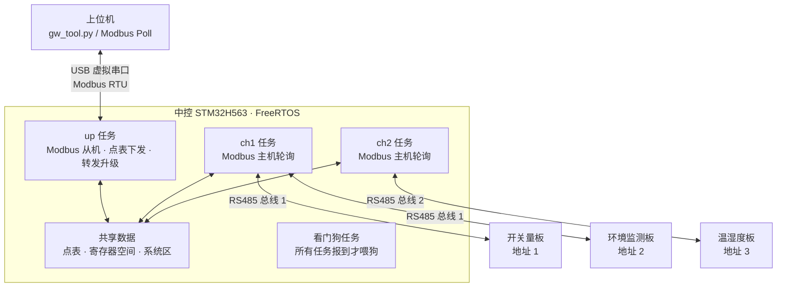

# Modbus 多通道网关（中控）

基于 STM32H563 + FreeRTOS 的 Modbus RTU 网关。上行通过 USB 虚拟串口做 Modbus 从机，下行两路 RS485 做 Modbus 主机轮询传感器。上位机只和中控通信，按"点表"访问所有传感器的数据。

支持在线下发点表（掉电保存）、通过 USB 升级中控自己（带 Bootloader）、通过中控转发升级下游传感器，并有任务看门狗和"启动就死机"保护。

## 来源说明

- 功能需求参考了百问网课程中"中控"的功能。本仓库的设计和代码为重新编写，不使用课程的中控代码和 libmodbus。
- 下游传感器节点（STM32F030）运行**课程提供的传感器固件**，本仓库不包含它的代码。中控按这份固件的私有升级协议转发固件，并在中控一侧补充了检查（见下文"转发升级传感器"）。
- 第三方组件：STM32CubeH5 HAL、FreeRTOS、TinyUSB 0.20.0，均保持各自原有许可。

## 功能

| 功能 | 说明 |
| --- | --- |
| 双通道轮询 | 两路 RS485 各一个任务，按点表合并成读块轮询；超时、重试、CRC 校验；连续失败 3 次判定掉线，掉线后每 2 s 重试一次 |
| 寄存器映射 | 上位机看到的是中控自己的地址空间（0x / 1x / 3x / 4x），点表决定每个地址对应哪个通道、哪个设备的哪个寄存器 |
| 写入下发 | 上位机写中控的线圈 / 寄存器 → 标记"待写入" → 下一轮下发到传感器；设备掉线时保留待写入，上电时不会把默认值误写给传感器 |
| 点表下发 | 上位机用 Modbus 0x15（写文件记录）发 CSV 编码后的点表；校验通过才换表，换表时两个通道暂停一轮；新表存进 Flash，先写数据最后写头，断电只会得到完整的表或"没有" |
| 系统区 | 4x 0xF000 起：版本、命令、最近错误、点表来源、复位原因、启动次数、每通道统计 |
| Bootloader + 升级中控 | 独立的 Bootloader（256 KB），通过 USB 收新固件；整包 CRC32 校验通过才写配置区，传输中断时旧 App 保持完好 |
| 看门狗 | 独立看门狗（4 s）+ 任务看门狗：两个通道任务和上行任务都要在 3 s 内报到，否则停止喂狗，让芯片复位 |
| 启动保护 | Bootloader 在备份寄存器里记录启动次数，App 稳定运行 5 s 后清零；连续 3 次没有稳定就留在 Bootloader，等待重新升级 |
| 转发升级传感器 | 上位机把传感器固件发给中控，中控转发给指定通道、指定地址的传感器（见下文） |

### 转发升级传感器

课程传感器的 Bootloader 不检查包序号，也不校验整个文件的 CRC，收到的长度够了就把固件标成有效。传感器固件改不了，所以中控在转发前后做了这些检查：

1. **扣住文件头**：收到文件头先不转发，等第 1 包到了，检查向量表（栈指针在传感器 RAM 范围内、复位入口在固件范围内），通过后再把文件头和第 1 包一起发出去。发错文件时传感器的 App 不会被擦。
2. **按序号检查**：序号不连续就拒绝；上位机重发上一包时，中控直接回成功，不再转发，防止传感器把同一包写两遍。
3. **最后一包前核对 CRC**：中控自己算整个文件的 CRC32，对不上就不发最后一包，传感器不会把这份固件标成有效。
4. **失败就整个重来**：中途任何一步失败，状态变成 broken，必须从文件头重新开始。

失败原因通过系统区 LAST_ERR（0x0601～0x0609）报给上位机。

## 系统结构



## 硬件

| 项目 | 内容 |
| --- | --- |
| 芯片 | STM32H563RIV6，Cortex-M33，250 MHz，2 MB Flash |
| RS485 CH1 | USART2（PA2 / PA3），115200 8N1，GPDMA，自动收发切换的 485 芯片 |
| RS485 CH2 | UART4（PA0 / PA1），115200 8N1，GPDMA |
| 日志 | USART3（PC10 / PC11），115200 |
| 上行 | USB 全速设备（PA11 / PA12），CDC 虚拟串口 |
| 传感器 | 3 块 STM32F030 板（开关量、环境监测、温湿度），课程硬件和固件 |

Flash 分区（8 KB 扇区）：

| 区域 | 地址 | 大小 |
| --- | --- | --- |
| Bootloader | 0x08000000 | 256 KB |
| App | 0x08040000 | 1776 KB |
| 点表区 | 0x081FC000 | 8 KB |
| 配置区（App 长度、CRC、版本、留在 Bootloader 标志） | 0x081FE000 | 8 KB |

## 上位机接口

中控是 Modbus 从机，地址 1。系统区（保持寄存器）：

| 地址 | 读 / 写 | 内容 |
| --- | --- | --- |
| 0xF000 | 写 | 命令：0x0001 重启、0x0002 清点表、0x0B00 进 Bootloader、0x0A00 清"留在 Bootloader"、0x0F01 / 0x0F02 故障测试 |
| 0xF001 | 读 | 状态：0 = App，1 = Bootloader |
| 0xF002 | 读 | 固件版本 |
| 0xF003 | 读 | 点表点数 |
| 0xF004 | 读 | 最近一次错误码 |
| 0xF005 | 读 | 点表来源（内置 / Flash / 本次下发） |
| 0xF006 | 读 | 上次复位原因（上电 / 复位键 / 软件 / 看门狗） |
| 0xF007 | 读 | 本次开机时的启动次数 |
| 0xF010 | 读写 | 转发目标：高字节通道，低字节设备地址 |
| 0xF011 | 写 | 写目标传感器的命令寄存器 |
| 0xF020 起 | 读 | 每通道 4 个统计：成功、超时、CRC 错、掉线设备数 |

上位机工具 `tools/gw_tool.py`（依赖 pyserial）：

```
python gw_tool.py COM9 info                                  # 系统区和通道统计
python gw_tool.py COM9 read 3x 10 2                          # 读中控 3x 10～11
python gw_tool.py COM9 write 0x 2 1                          # 写线圈
python gw_tool.py COM9 points points_default.csv             # 下发点表
python gw_tool.py COM9 upgrade central.bin 8                 # 升级中控
python gw_tool.py COM9 upgrade-sensor 1 2 demo_f030_app.bin 0x101   # 升级 ch1 地址 2 的传感器
python gw_tool.py COM9 test-hang                             # 故障测试：任务卡住 → 看门狗复位
```

点表 CSV 每行一个点：`表,通道,设备地址,中控地址,传感器寄存器地址`，例如 `3x,1,2,10,0` 表示中控 3x 10 = ch1 地址 2 的设备的 3x 0。

## 实测（2026-10-26，开发板 + 课程传感器）

| 项目 | 结果 |
| --- | --- |
| ch1 轮询（2 块传感器，6 个读块） | 10 s 内 152 轮、912 次读 |
| USB 升级中控（96720 字节） | 发送 0.8 s，Bootloader 写 Flash 265 ms（擦 14 个扇区） |
| 转发升级环境监测板（23764 字节，107 包） | 7.6 s；文件头因为传感器要先擦 Flash，295 ms 后才回应 |
| 任务卡住（test-hang） | 卡住后 3.8 s 检测到、停止喂狗，随后独立看门狗复位；重启后复位原因读出为"看门狗" |
| 启动就死机（test-crash） | 连续 3 次后留在 Bootloader，`run-app` 恢复 |
| 升级时拔 USB | 旧 App 完好，重新升级成功 |
| FreeRTOS 堆（32 KB） | 剩余 13952 字节，历史最低 13320 字节 |

完整的测试步骤和数据见 `docs/` 下的测试报告（补充中）。各部分为什么这样设计见 [`docs/design.md`](docs/design.md)，调试中遇到的问题和排查过程见 [`docs/debug-log.md`](docs/debug-log.md)。

## 目录

```
firmware/boot/          Bootloader（0x08000000，Keil 工程 MDK-ARM/boot.uvprojx）
  App/                    app_flash.c（新固件写进 App 区，断电安全）、boot_proto.c（Bootloader 的系统区和 0x15）
  Core/                   boot_main.c（判断、跳转、主循环）、boot_usb.c（裸机 TinyUSB）、boot_log.c、boot_it.c
firmware/central/       中控固件（App，0x08040000；CubeMX 生成 + Keil MDK 工程）
  App/                  自己写的模块
    log.c/.h              带等级的日志：队列 + 低优先级任务，中断里不打印
    mb_rtu.c/.h           Modbus RTU 协议层：CRC、按功能码判断帧长、从机处理、主机组帧与解析
    port_uart.c/.h        串口收发：DMA + 空闲中断接收、流缓冲区、DMA 发送
    mb_master.c/.h        主机请求层：帧间隔、回显处理、超时、重试、统计；通过函数指针 mb_io_t 收发
    dev_health.c/.h       设备在线状态：连续失败 3 次判定掉线，掉线后每 2 s 重试一次
    point_table.c/.h      点表：文件解析、校验、排序、合并读块；default_points.c 是内置默认表
    reg_space.c/.h        中控寄存器空间：映射区（点表决定）+ 系统区；"待写入"标记
    point_sync.c/.h       点同步：每轮先下发待写入的点，再按读块读回；掉线降频
    crc32.c/.h            CRC-32（和 zlib 相同）
    file_rx.c/.h          0x15 文件接收：文件头 + 224 字节分包，重发 / 跳包 / CRC32
    table_loader.c/.h     点表下发：收文件 → 校验 → 解析到临时表
    gw_data.c/.h          共享数据、互斥锁、换表用的轮锁；开机选点表、换表后存 Flash；借用通道转发
    flash_layout.h        Flash 分区
    flash_io.h            擦写 Flash 的函数指针（板子上用 HAL，PC 测试用假 Flash）
    flash_if.c/.h         HAL 擦写（8 KB 扇区、16 字节写），只允许擦写指定窗口
    pt_store.c/.h         点表存 Flash
    boot_cfg.c/.h         配置区和 Bootloader 开机判断
    boot_guard.c/.h       启动次数、复位原因；guard_hw.h 是备份寄存器和 IWDG
    wd.c/.h               任务看门狗的判断：所有任务都按时报到才喂狗
    wdog.c/.h             看门狗任务、故障测试命令
    fwd.c/.h              转发给传感器：命令寄存器、0x15 固件（扣住文件头、按序号去重、最后一包前核对 CRC）
    poll_task.c/.h        两路 RS485 各一个通道任务
    port_usb.c/.h         USB 虚拟串口（CDC）收发，基于 TinyUSB
    usb_descriptors.c     USB 描述符；tusb_config.h 是 TinyUSB 配置
    sys_regs.c/.h         系统区寄存器
    up_link.c/.h          上行任务：USB 收一帧 → 从机处理 / 转发 → 回一帧
  Middlewares/Third_Party/tinyusb/   TinyUSB 0.20.0（MIT），只保留用到的部分
  Core/ Drivers/ Middlewares/   CubeMX 生成
tools/                  上位机工具 gw_tool.py 和示例点表
tests/                  PC 端单元测试
  run_tests.bat           Windows 一键编译运行（需要 gcc）
  stubs/                  FreeRTOS / HAL 的替身头文件
  fake_bus.h              模拟 RS485 总线和从机（假时间）
  fake_flash.h            模拟 Flash（扇区擦除、16 字节写、不能写两次、模拟断电）
docs/                   设计文档 design.md、调试记录 debug-log.md；测试报告（补充中）
```

## 编译和下载

Keil MDK 5（ARM Compiler 6）：

1. `firmware/boot/MDK-ARM/boot.uvprojx`：F7 编译、F8 下载（Bootloader 只需要烧一次）
2. `firmware/central/MDK-ARM/central.uvprojx`：F7、F8。编译后生成 `MDK-ARM/central/central.bin`

之后不用调试器，通过 USB 升级 App：

```
python tools/gw_tool.py COM9 upgrade firmware/central/MDK-ARM/central/central.bin 8
```

## 测试

PC 端单元测试不依赖硬件：FreeRTOS、HAL 用替身头文件，RS485 总线和 Flash 用模拟实现（Flash 测试会在每一步操作前模拟断电）。

```
tests\run_tests.bat
```

或手动（以 mb_rtu 为例）：

```
gcc -std=c99 -Wall -Wextra -I firmware/central/App firmware/central/App/mb_rtu.c tests/test_mb_rtu.c -o test_mb_rtu
./test_mb_rtu
```

17 组共 543 项：

| 测试 | 用例数 | 测试 | 用例数 |
| --- | --- | --- | --- |
| `test_mb_rtu.c` | 74 | `test_table_loader.c` | 23 |
| `test_log.c` | 14 | `test_pt_store.c` | 31（每一步断电） |
| `test_dev_health.c` | 19 | `test_boot_cfg.c` | 33 |
| `test_mb_master.c` | 31 | `test_app_flash.c` | 24（每一次 Flash 操作前断电） |
| `test_sys_regs.c` | 45 | `test_boot_proto.c` | 31（真实请求帧走完整升级） |
| `test_point_table.c` | 36 | `test_boot_guard.c` | 33 |
| `test_reg_space.c` | 34 | `test_wd.c` | 31 |
| `test_point_sync.c` | 29 | `test_fwd.c` | 35（模拟课程传感器 Bootloader） |
| `test_file_rx.c` | 20 | | |

## 已知问题

- **温湿度板（ch2）未接通**：中控 ch2 发出请求，收不到任何回复。还没分清是温湿度板还是中控 ch2 的问题，排查中。ch2 的代码和 ch1 相同，在 PC 测试里覆盖。
- **开机第一帧偶尔超时**：上电或重启后 ch1 的前几次请求偶尔超时，之后正常。怀疑是复位时 RS485 线上的毛刺，未确认。
- **转发时放宽了字节间隔**：课程传感器回应较长的帧时中途会停顿，转发期间中控把字节间隔从 5 ms 放宽到 30 ms（见调试记录第 11 条）。

## 许可

`App/`、`tests/`、`tools/` 下自己编写的文件采用 MIT 许可；CubeMX 生成的文件、HAL、CMSIS、FreeRTOS、TinyUSB 保持各自原有许可。
