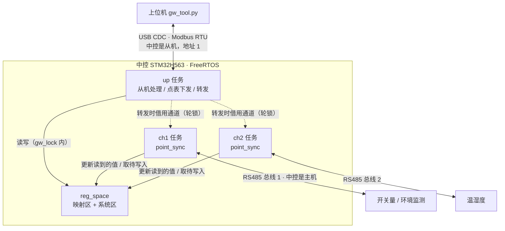

# 设计文档：Modbus 多通道网关（中控）

本文说明中控各部分**是怎么设计的、为什么这样设计**。功能和用法见 [README](../README.md)，调试中遇到的问题见 [debug-log.md](debug-log.md)。

## 1. 目标和约束

| 目标 | 说明 |
| --- | --- |
| 上位机只和中控通信 | 上位机不需要知道传感器挂在哪条总线、地址是多少，只按中控的地址读写 |
| 点表可配置 | 换传感器、加点不改中控代码，下发一张新点表即可；断电后保留 |
| 两路总线互不影响 | 一条总线上的设备掉线、超时，不拖慢另一条 |
| 能在线升级 | 中控自己和下游传感器都能通过 USB 升级，不用拆调试器；升级中途断电、发错文件都不能把设备变"砖" |
| 出问题能自己恢复 | 任务卡住、新固件一启动就死机，都要能回到可用状态 |
| 代码可测试 | 协议和业务逻辑不碰硬件，能在 PC 上编译、跑单元测试 |

约束：下游传感器使用课程提供的 STM32F030 固件，它的私有升级协议**不能改**，中控只能适配。

## 2. 系统结构

数据流：

- **读**：通道任务按点表轮询传感器，把读到的值写进 `reg_space`；上位机读中控时直接从 `reg_space` 取，不等总线。
- **写**：上位机写中控时，`reg_space` 只记下"待写入"和值；通道任务下一轮先把待写入的点写给传感器，成功后清除标记。
- **转发**：上位机要直接操作某个传感器（升级）时，up 任务暂停那个通道的轮询，借它的串口发请求、等回应。

## 3. 模块划分

**分层原则：协议和业务逻辑不碰硬件，硬件相关的代码越薄越好。**纯逻辑模块通过函数指针拿到"收发一帧""擦写 Flash"这类能力，PC 测试时换成模拟实现。

| 层 | 模块 | 职责 | PC 测试 |
| --- | --- | --- | --- |
| 协议 | `mb_rtu` | CRC、按功能码算帧长、帧组装器、从机处理、主机组帧和解析 | ✅ |
| 主机请求 | `mb_master` | 发请求、等回应、超时、重试、回显处理、统计 | ✅（模拟总线） |
| 业务 | `dev_health` | 设备在线状态 | ✅ |
| 业务 | `point_table` | 点表解析、校验、合并读块 | ✅ |
| 业务 | `reg_space` | 中控地址空间、待写入标记 | ✅ |
| 业务 | `point_sync` | 一个通道一轮的同步逻辑 | ✅（模拟总线） |
| 业务 | `file_rx`、`table_loader` | 0x15 文件接收、点表下发 | ✅ |
| 业务 | `pt_store`、`boot_cfg`、`app_flash` | 点表存储、配置区、写 App 区 | ✅（模拟 Flash + 断电） |
| 业务 | `boot_guard`、`wd` | 启动次数、任务看门狗判断 | ✅ |
| 业务 | `fwd` | 转发给传感器的检查和状态 | ✅（模拟课程传感器 Bootloader） |
| 硬件 | `port_uart`、`port_usb`、`flash_if`、`guard_hw.h` | 串口 DMA、USB CDC、HAL Flash、备份寄存器和 IWDG | — |
| 组装 | `poll_task`、`up_link`、`wdog`、`gw_data` | 创建任务、把模块连起来、锁 | — |

## 4. 任务和并发

| 任务 | 优先级（Idle + n） | 栈 | 说明 |
| --- | --- | --- | --- |
| `wdog` | 6 | 1 KB | 检查各任务有没有报到，决定是否喂独立看门狗 |
| `usbd` | 5 | 2 KB | TinyUSB 事件处理（枚举、端点完成）要及时 |
| `up` | 4 | 4 KB | 上位机请求要及时回应；转发时调用层次深，栈比别的任务大 |
| `ch1`、`ch2` | 3 | 3 KB | 每个通道独占一个串口，轮询之间互不阻塞 |
| `log` | 1 | 1 KB | 日志队列，只在空闲时输出，中断和高优先级任务里不直接打印 |

实测：两个通道任务栈剩余 484～492 字（共 768 字）；FreeRTOS 堆 32 KB，剩余 13952 字节，历史最低 13320 字节。

**两把锁：**

| 锁 | 保护什么 | 持有时间 | 规则 |
| --- | --- | --- | --- |
| `gw_lock`（互斥锁） | `reg_space`、点表、系统区 | 微秒级 | 锁里**不做任何收发** |
| 轮锁（每通道一把） | "这个通道这一轮正在用串口" | 一轮（几十 ms） | 通道任务每轮持有；换点表、转发时由 up 任务拿到它，通道就停在两轮之间 |

这样分开的原因：如果只用一把锁、在锁里收发 RS485，一次超时 100 ms 期间上位机的请求全都要等，USB 那边会超时。

## 5. 协议

### 5.1 链路

| | 上行（PC ↔ 中控） | 下行（中控 ↔ 传感器） |
| --- | --- | --- |
| 物理层 | USB CDC 虚拟串口 | RS485，115200 8N1，自动收发切换 |
| 角色 | 中控是从机，地址 1 | 中控是主机 |
| 帧结束 | 按功能码算长度 + 50 ms 字节间超时 | 按功能码算长度 + 5 ms 字节间超时 |
| 回应超时 | — | 100 ms，失败再试 2 次；掉线设备不重试 |

**帧结束为什么按长度算，不靠 3.5 字符间隔：**上行是 USB，数据按 USB 包到达，没有"字符间隔"这回事；下行用 DMA + 空闲中断，一帧也可能分几次到达。所以 `mb_frame_need()` 根据功能码和长度字段算出整帧应有的长度，收够了就是一帧。字节间超时只用来丢弃残帧，防止一直卡在半帧上。

### 5.2 中控地址空间

| 区域 | 地址 | 说明 |
| --- | --- | --- |
| 映射区 | 0x / 1x / 3x / 4x 各 0～499 | 点表决定每个地址对应哪个通道、哪个设备的哪个寄存器；没映射的地址回异常码 02 |
| 系统区 | 4x 0xF000～0xF0FF | 中控自己的状态和命令，不进点表（寄存器列表见 README） |

系统区独立出来的好处：升级传感器时，上位机写"目标 + 命令"就行，不用为了一条命令临时修改点表。

### 5.3 文件传输（功能码 0x15）

| `file_no` | 文件 |
| --- | --- |
| 0x0000 | 点表 |
| 0x1000 | 中控自己的固件（只在 Bootloader 里接收） |
| 0x1000 \| (通道 << 8) \| 设备地址 | 发给某个传感器的固件，例如 0x1102 = ch1 地址 2 |

- `record_no` 0 是 32 字节文件头：版本、长度、加载地址、CRC32、文件名，大端。格式和课程传感器固件一致，转发时不用改写。
- `record_no` 1、2、3……是数据，每包 224 字节，最后一包可以更短。

**为什么每包 224 字节：**0x15 的字节数字段最大 0xF5，减去 7 字节子请求头，一包数据最多 238 字节。224 不超过 238，又是 16（H563 一次写 16 字节）和 4（F030 一次写 4 字节）的公倍数。

**点表文件格式**（自己定义）：每个点 8 字节，大端：表（1 字节）、通道（1）、设备地址（1）、保留（1）、中控地址（2）、传感器寄存器地址（2）。中控逐项校验：表和通道合法、地址不超过 499、同一个"表 + 中控地址"不能重复、点数和设备数不超过上限。任何一条不满足，整张表拒绝，旧表继续生效。

## 6. 点同步（`point_sync`）

每个通道一个任务，每轮：

1. 先写：取出本通道所有"待写入"的点，逐个写给传感器。成功就清标记，失败就保留，下一轮再试。
2. 再读：按读块读回（同一设备、同一张表、地址连续的点在加载点表时合并成一个读块，最多 16 个点）。读到的值只有在该点**没有待写入**时才更新进映射区。
3. 掉线处理：同一设备连续失败 3 次判定掉线，之后每 2 s 才试一次，且不重试，避免一个掉线设备拖慢整条总线。
4. 一轮结束睡 50 ms，给低优先级任务留时间。

**为什么用"待写入"标记，不比较新旧值：**比较新旧值的做法有三个问题：
- 上电时映射区全是 0，会把 0 写到所有输出点；
- 只读寄存器的值变化也会被当成"要写"；
- 轮询读回来的值可能覆盖上位机刚写进去、还没下发的值。

用"待写入"标记后，这三种情况都不会发生（PC 测试和上板都验证了"上电不误写"）。

实测：ch1 上 2 块传感器、6 个读块，10 s 内 152 轮、912 次读。

## 7. 点表下发和保存

流程：上位机用 0x15 发点表文件 → `file_rx` 检查序号、长度、CRC32 → `table_loader` 解析校验到临时表 → 拿到两个通道的轮锁（通道停在两轮之间）→ 换表 → 放开轮锁 → 存进 Flash。

**存 Flash 的顺序：擦扇区 → 写数据 → 最后写头。**头里有魔数、数据长度、数据 CRC32 和头自己的 CRC32。

| 断电时刻 | 下次开机读到的 | 结果 |
| --- | --- | --- |
| 写数据时 | 头是擦除后的 0xFF，魔数不对 | 当作"没有保存过"，用内置默认表 |
| 写头时 | 头的 CRC 不对 | 同上 |
| 写完以后 | 完整的头和数据 | 用新表 |

所以任何时候断电，读到的要么是完整的表，要么是"没有"，不会是半张表。代价是断电那一次连旧表也丢了，回到默认表；要保住旧表需要两个扇区轮流写（见第 11 节）。

## 8. Bootloader 和升级中控

### 8.1 Flash 分区

| 区域 | 地址 | 大小 |
| --- | --- | --- |
| Bootloader | 0x08000000 | 256 KB |
| App | 0x08040000 | 1776 KB |
| 点表区 | 0x081FC000 | 8 KB |
| 配置区 | 0x081FE000 | 8 KB |

配置区 32 字节：魔数 `'GWCF'`、App 长度、App CRC32、版本、"留在 Bootloader"标志、保留、本结构的 CRC32。

### 8.2 开机判断

Bootloader 在初始化外设之前就做判断，App 正常时尽快跳过去：

| 条件 | 结果 |
| --- | --- |
| 配置有效、App 的 CRC 对、向量表合理 | 跳到 App |
| 没有配置，但 App 区的向量表合理（用调试器直接下载的 App） | 不查 CRC，直接跳 |
| 上位机要求留下（标志 = 1） | 留在 Bootloader |
| 没有配置，向量表也不合理 | 留下（App 区是空的） |
| 长度不合理 / CRC 不对 / 向量表不合理 | 留下（升级没完成、Flash 坏了、下载了按别的地址编译的固件） |
| App 连续 3 次启动都没稳定（第 9 节） | 留下 |

"向量表合理"指：初始栈指针在 RAM 范围内，复位入口在 App 区内。

跳转用 C 写：关中断、停 SysTick、清挂起的中断、设置 `SCB->VTOR`、设置 MSP、调用 App 的复位函数。

### 8.3 升级流程

1. 上位机写命令 0x0B00 → App 在配置区写"留下"标志 → 复位进 Bootloader（USB 断开重连，工具自动重新打开串口）
2. 用 0x15、`file_no` 0x1000 发固件，Bootloader 先整个收进 RAM
3. 整个文件的 CRC32 对、加载地址是 App 区、向量表合理，才开始动 Flash（传输中断不影响旧 App）
4. 写 Flash 分 7 步，每一步断电都安全：

| 步骤 | 做什么 | 这一步之后断电，开机会怎样 |
| --- | --- | --- |
| 1 | 配置区写成"留下"、App 长度 0 | 留在 Bootloader |
| 2 | 擦 App 用到的扇区 | 留在 Bootloader |
| 3 | 写第 16 字节以后的内容 | 留在 Bootloader |
| 4 | 核对 CRC | 留在 Bootloader |
| 5 | **最后写前 16 字节**（初始栈指针 + 复位入口） | 留在 Bootloader |
| 6 | 核对整个 App 的 CRC | 留在 Bootloader |
| 7 | 配置区写入长度、CRC、版本，仍是"留下" | 留在 Bootloader，等上位机启动 |

5. 上位机写 0x0A00 → 清"留下"标志 → 复位跳到新 App

向量表最后写的原因：万一配置区在第 1 步就坏了，Bootloader 会走"没有配置、看向量表"那条路；向量表没写之前是 0xFF，不合理，就不会跳进写了一半的 App。PC 测试里在每一次 Flash 操作前模拟断电，检查开机判断的结果。

实测：96720 字节，发送 0.8 s，写 Flash 265 ms（14 个扇区）；传输中拔 USB，旧 App 完好。

## 9. 看门狗和启动保护

### 9.1 任务看门狗

独立看门狗（IWDG，LSI 32 kHz / 64，重装值 2000）4 s 不喂就复位。但"有人在喂"不等于"系统正常"：如果只在某个任务里喂，其他任务卡死了也发现不了。

所以：
- ch1、ch2、up 三个任务每次循环都调用 `wdog_beat()` 报到；
- `wdog` 任务（最高优先级）检查：**所有任务**都在 3 s 内报到过，才喂狗；有一个超时就停止喂，4 s 内芯片复位；
- 任务事先知道自己要等很久时（转发时等传感器擦 Flash），先调用 `wdog_allow()` 声明，这段时间不算卡住。

### 9.2 防"启动就死机"

如果新固件一启动就死机，看门狗复位后又会跳进同一个 App，无限循环。所以：

1. Bootloader 每次跳 App 前，把 TAMP 备份寄存器里的"启动次数"加 1（备份寄存器复位不清零）；
2. App 稳定运行 5 s（所有任务都报到过）后，把启动次数清零，这叫"确认"；
3. 启动次数到 3 还没确认，Bootloader 就不跳了，留下等上位机重新升级。

复位原因从 `RCC_RSR` 读，按"看门狗 > 软件 > 欠压 > 复位脚"的优先级判断，放在系统区 0xF006。

实测：卡住后 3.8 s 检测到并停止喂狗，随后复位，复位原因读出为"看门狗"；`test-crash` 连续 3 次后留在 Bootloader，`run-app` 恢复。调试中遇到过备份寄存器写不进去的问题，见调试记录第 10 条。

## 10. 转发升级传感器

### 10.1 课程传感器的升级协议

从课程传感器源码读出来的：

| 操作 | 传感器的做法 |
| --- | --- |
| 写 4x 0 = 0x55 | 在 App 里：写配置、复位进 Bootloader |
| 写 4x 0 = 0xAA | 在 Bootloader 里：启动 App |
| 0x15，`file_no` 1，记录 0 | 按文件长度擦 App 区和配置区，然后回应 |
| 0x15，记录 1 起 | 按顺序写进 Flash，**不检查记录号**，重复的包会再写一遍 |
| 收完 | **不校验 CRC**，收到的长度够了就把配置标成有效 |

### 10.2 中控补充的检查

传感器固件改不了，中控在转发时补上：

| 检查 | 做法 | 防的是什么 |
| --- | --- | --- |
| 扣住文件头 | 收到文件头先不转发；等第 1 包到了，检查向量表（栈指针在 F030 的 RAM 内、复位入口在固件范围内），通过后再发文件头和第 1 包 | 发错文件时传感器的 App 被擦掉 |
| 按序号 | 跳包、没有文件头就来数据都拒绝；上位机重发上一包时直接回成功，不再转发 | 传感器把同一包写两遍 |
| 最后一包前核对 CRC | 中控自己累计整个文件的 CRC32，对不上就不发最后一包 | 传感器把错误的固件标成有效 |
| 失败就重来 | 任何一包失败，状态变成 broken，必须从文件头重新开始 | 传感器 Flash 里留下拼接错位的固件 |

不同的包超时不同：文件头 3 s（传感器要先擦 Flash）、再试 1 次；数据包 1 s、不重试（重试可能导致重复写）；命令 0.5 s、再试 2 次。失败原因通过 LAST_ERR 0x0601～0x0609 报给上位机。

转发在 up 任务里执行，不持有 `gw_lock`：拿到目标通道的轮锁，借用这个通道的 `mb_master`，临时改超时、重试次数和字节间隔，用完恢复。

### 10.3 上板时发现的问题

第一次上板时文件头一直失败：传感器擦完 Flash 后回 44 字节，中途有停顿，超过了 5 ms 的字节间隔，中控把前半段当残帧丢了，结果 CRC 错。转发期间把字节间隔放宽到 30 ms 后通过（调试记录第 11 条）。

实测：23764 字节、107 包，7.6 s；文件头 295 ms 后才回应（擦 Flash 的时间）。

## 11. 已知限制和可以改进的地方

| 限制 | 现在的影响 | 可以怎么改 |
| --- | --- | --- |
| 点表只用一个扇区 | 保存时断电会丢掉旧表，回到默认表 | 两个扇区轮流写，头里带保存次数，开机取有效的、次数大的那个 |
| 中控只有一个 App 区 | 新 App 有问题时只能留在 Bootloader 等重新升级，不能自动回到旧版本 | 双 App 区（H563 有两个 Bank，支持交换），确认失败自动回退 |
| 固件没有签名 | 只校验 CRC，能防传输错误，防不了被替换 | 加签名校验（如 ECDSA），Bootloader 验签后才写 |
| 转发时字节间隔放宽到 30 ms | 转发期间如果总线上有干扰，残帧要等更久才丢弃 | 只对文件头放宽，或者测出传感器回应的实际停顿时间再定 |
| 课程传感器的升级协议本身不可靠 | 已在中控侧补检查；但如果绕过中控直接升级传感器，这些检查都没有 | 传感器 Bootloader 加 CRC 校验和序号检查 |
| 温湿度板（ch2）未接通 | ch2 的功能只在 PC 测试里验证 | 排查中 |
